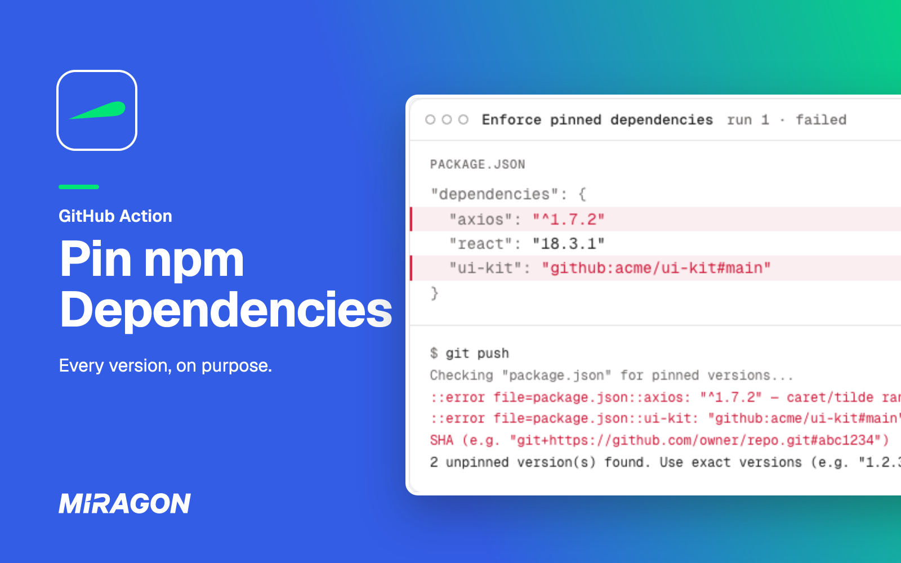
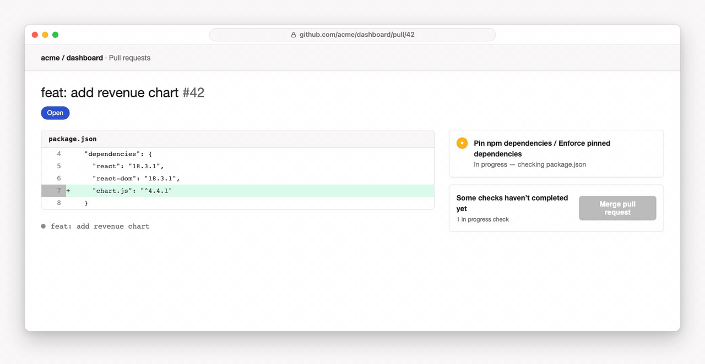

# pin-npm-dependencies

[](https://github.com/marketplace/actions/pin-npm-dependencies)
[](https://github.com/Miragon/pin-npm-dependencies/actions/workflows/test.yml)
[](LICENSE)



A GitHub Action for npm, yarn and pnpm that fails the pull request when a `package.json` uses a version range, `latest` or a git branch instead of an exact version.

## Why

`"axios": "^1.7.2"` installs the newest `1.x` release at install time; on March 31, 2026 that was a hijacked `axios@1.14.1` carrying a remote access trojan. A lockfile holds only until someone adds or updates a package, which coding agents and update bots do in their pull requests. Exact versions turn every update into a change someone reviews ([Why pin](https://miragon.github.io/pin-npm-dependencies/why-pin)).

## What you get

- **A red check before any install script runs.** Each finding fails the job with an annotation on its `package.json`.
- **Exact versions and commit SHAs pass.** Git tags pass too, though they can move ([Rules](https://miragon.github.io/pin-npm-dependencies/reference/rules)).
- **Every field that installs a package.** `dependencies`, `devDependencies`, `optionalDependencies`, and `peerDependencies` on request; transitive versions stay with your lockfile ([Guarantees and limits](https://miragon.github.io/pin-npm-dependencies/guarantees)).
- **Whole monorepos in one step.** Every `package.json` outside `node_modules`, `.git`, `dist` and `build`, or one package, or a list of files ([Monorepos](https://miragon.github.io/pin-npm-dependencies/monorepos)).
- **One required check across repositories.** Report first, pin, then enforce ([Roll out](https://miragon.github.io/pin-npm-dependencies/rollout)).
- **Nothing leaves the runner.** No network request, no token, no changed files.



## Install

Add the step to a pull request job, before the install:

```yaml
on: pull_request

jobs:
  build:
    runs-on: ubuntu-latest
    steps:
      - uses: actions/checkout@3d3c42e5aac5ba805825da76410c181273ba90b1 # v7.0.1

      - name: Enforce pinned dependencies
        uses: miragon/pin-npm-dependencies@3f7f02fa2454cdd2cdb65df19b081c0d77d301a5 # v1.2.2

      - run: npm ci
```

Optional inputs choose the files and dependency fields: [Inputs and output](https://miragon.github.io/pin-npm-dependencies/reference/inputs).

## Get started

1. Open a pull request that adds the step.
2. The check fails on each range: write the version your lockfile installs (`npm ls`, `yarn why`, `pnpm why`), or a commit SHA for a git dependency, and reinstall.
3. Push `package.json` and the lockfile, and the check turns green.

[Getting started](https://miragon.github.io/pin-npm-dependencies/getting-started) walks through it and [Fix findings](https://miragon.github.io/pin-npm-dependencies/fixing) pins each kind of finding and stops tools from writing new ranges.

## Help and feedback

- **Documentation:** guides, rules and limits at [miragon.github.io/pin-npm-dependencies](https://miragon.github.io/pin-npm-dependencies/).
- **Bugs and ideas:** a value flagged by mistake or a range that slips through? [Open an issue](https://github.com/Miragon/pin-npm-dependencies/issues).
- **Security:** report vulnerabilities privately via [SECURITY.md](SECURITY.md).

## Contributing

How to run the tests, preview the docs and release the action is in [CONTRIBUTING.md](CONTRIBUTING.md).

## License

[MIT](LICENSE) © Miragon GmbH
